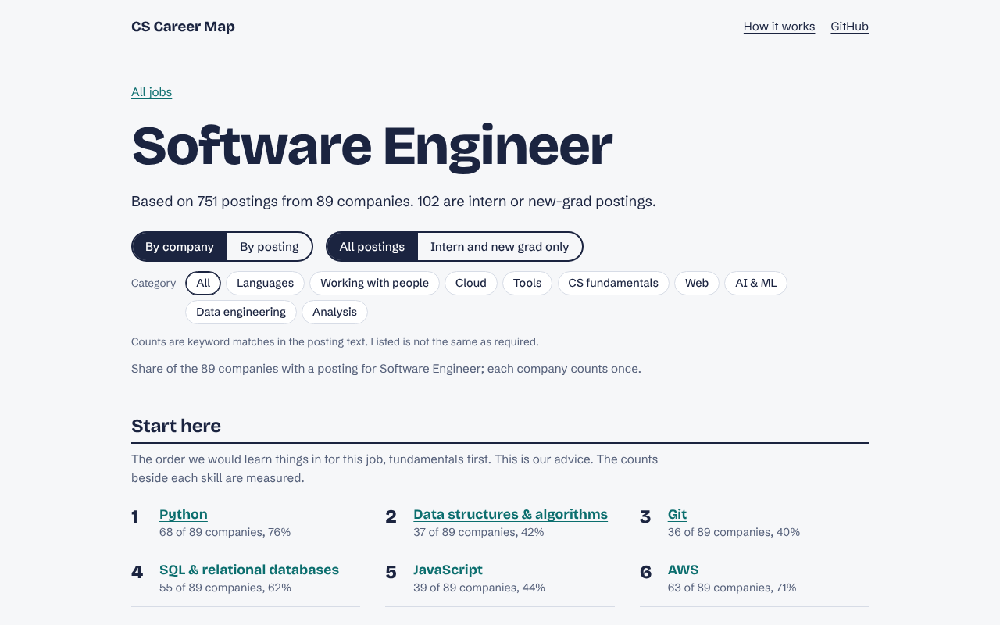

# CS Career Map

Which skills do job postings ask for? This project counts.

For each job, CS Career Map reads public postings from company career pages, counts how many companies ask for each skill, and pairs every skill with checked places to learn it and a small project that proves you can do it. It ships as a website and as a Claude skill that coaches you through the plan.

**Live site:** <https://emmazhao422.github.io/cs-career-map/>



Data was first collected on 21 November 2026 and refreshes every Monday. The matching rules were audited the same day; what was found, fixed and left open is in [AUDIT.md](AUDIT.md).

## Why another roadmap

Most learning roadmaps are written from experience: an editor decides what belongs on the path. This one starts from evidence you can check.

- **Organised by job, not by technology.** Software Engineer, AI Engineer and Data Analyst to start.
- **Every skill shows its count.** "41 of 60 postings" with the date they were read, plus the list of postings behind it.
- **Intern and new-grad view.** One switch recounts using only entry-level postings.
- **The hiring side is on the page.** Postings are wish lists. Skills carry notes summarised from companies' own public hiring pages, each with its source, and people who hire can add what they look for in practice. Both are shown separately from the counts.
- **Short guides for every skill.** What knowing it looks like, at most two resources (official documentation and university courses first), one project.

## How the numbers are made

1. Once a week a script reads the public job boards of the companies in [`config/companies.json`](config/companies.json). It uses the public job board APIs of Greenhouse and Lever, the same listings a company's careers page shows.
2. It keeps postings whose title matches a job in [`config/roles.json`](config/roles.json) and skips senior, staff, lead and manager titles. The same title at one company counts once, even when it is listed in several locations.
3. It checks each posting against the skill patterns in [`config/taxonomy.json`](config/taxonomy.json) and saves the link and the matched skill names. Text a company repeats in most of its postings is ignored, and so is the company's own name. **The posting text is not stored.**
4. It writes the counts the site reads, under `docs/data/`.

A posting stays in the sample for 120 days after it was last seen open.

### What this cannot tell you

- Postings are wish lists. Listed is not the same as tested.
- Only companies that publish through Greenhouse or Lever are read. Companies with their own careers system, including several of the largest, are not counted yet.
- Matching is by keyword. It can miss a skill described in unusual words and over-count a word used in another sense. The patterns and their tests are in the repository; fixes are welcome.
- A company with many open postings weighs more. Each skill also shows how many different companies mention it.
- Guides and "learn first" links are editorial opinions.

## Run it yourself

Python 3.9 or newer. No packages to install.

```bash
python -m unittest discover -s collector      # run the tests
python collector/collect.py collect           # read the job boards, rebuild the site data
python collector/collect.py build             # rebuild the site data from stored postings
python -m http.server 8000 --directory docs   # open http://localhost:8000
```

`python collector/demo_data.py` regenerates the labeled demo data.

## Repository layout

| Path | What it is |
| --- | --- |
| `config/` | Jobs, skill patterns and the company list. Edit these to change what is counted. |
| `collector/` | The script that reads job boards and builds the data, with its tests. |
| `data/postings/` | One file per job: a link and the matched skills for each posting. |
| `data/skill_guides.json` | The learning guide for each skill. |
| `data/practitioner_notes.json` | Notes from the hiring side: summaries of public hiring pages, and notes sent in by practitioners. |
| `docs/` | The website. Plain HTML, CSS and JavaScript, no build step. |
| `skill/cs-career-coach/` | The Claude skill, with its own copy of the data. |

## Use the coach

`skill/cs-career-coach/` is a Claude skill: a folder with a `SKILL.md` and a copy of the data. It reads the live data from the site when it can and falls back to the bundled copy. It has been run through sample student requests but not yet used by real students. Add the folder to Claude as a skill, then ask something like "coach me toward a data analyst internship; I have ten hours a week". It builds a plan from the counts, teaches one skill at a time, and only recommends resources from this repository.

## Contribute

See [CONTRIBUTING.md](CONTRIBUTING.md). The most useful things you can do:

- **You hire or interview for one of these jobs:** [add a practitioner note](../../issues/new?template=practitioner-note.yml).
- **You know a better free resource:** [suggest it](../../issues/new?template=suggest-resource.yml).
- **A company is missing:** [add its job board](../../issues/new?template=add-company.yml).

## Who made this

CS Career Map is a project by Emma Zhao. The first version of the code, the site and the learning guides was written with Claude, Anthropic's AI model, working to her direction: what to build, for whom, and where the data should come from. The commit history shows who wrote what.

## License

Code is under the [MIT License](LICENSE). Linked learning resources belong to their authors.
